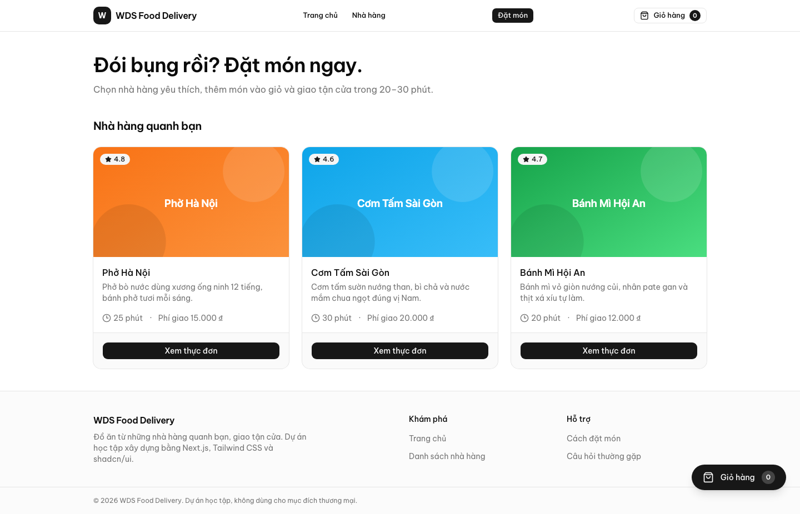
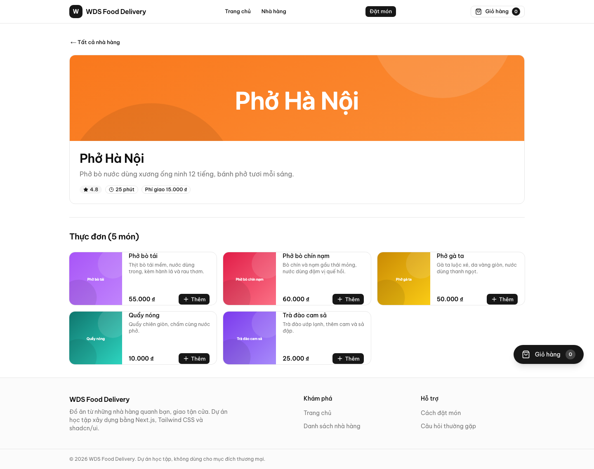
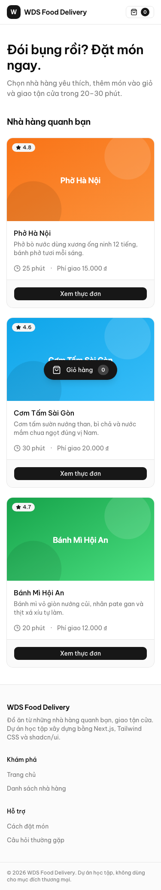
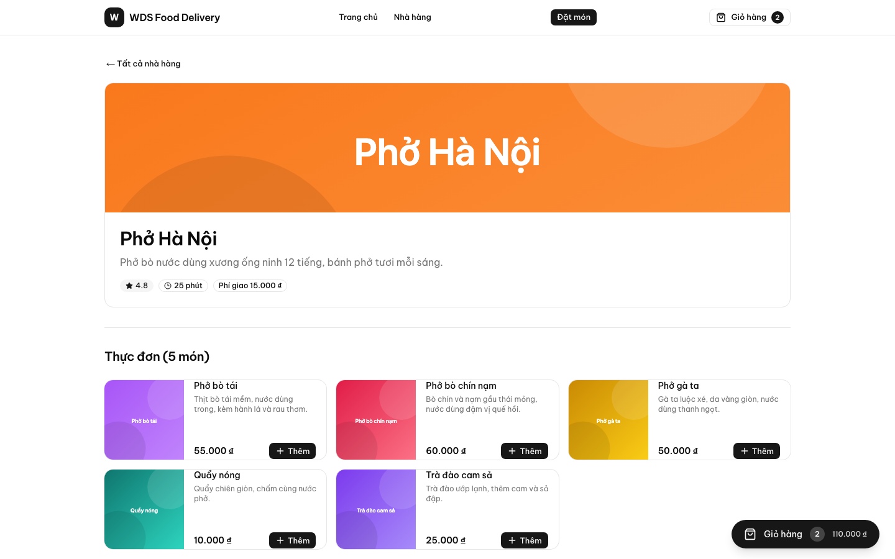
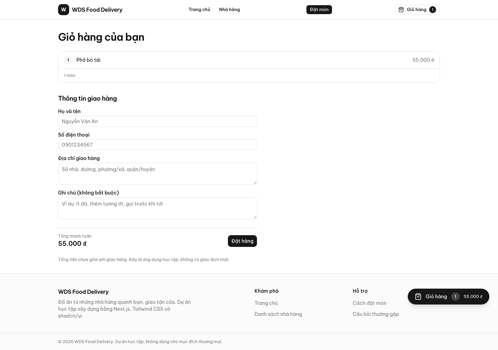
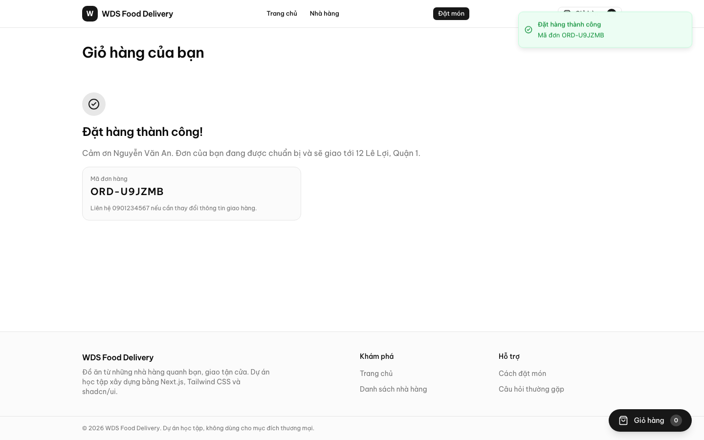

# WDS Food Delivery App — Frontend

Ứng dụng đặt món ăn (Food Delivery) — dựng lại toàn bộ phần Frontend bằng **Next.js 16
(App Router)**, **Tailwind CSS**, **shadcn/ui** và **Zustand**.

Khách xem danh sách nhà hàng, mở menu, thêm món vào giỏ, rồi đặt hàng qua form giao hàng
có validate tiếng Việt.

## Tech stack

| Lớp | Công nghệ |
| --- | --- |
| Framework | Next.js 16 (App Router, Server Components) |
| Ngôn ngữ | TypeScript (strict) |
| Styling | Tailwind CSS + shadcn/ui |
| State | Zustand (+ persist LocalStorage) |
| Form & validate | React Hook Form + Zod |
| Thông báo | Sonner (toast) |
| Mock API | Next.js Route Handler |
| Package manager | pnpm |

## Yêu cầu môi trường

- Node.js LTS
- pnpm
- Git
- Docker Desktop
- OpenCode + VS Code

```sh
node -v
pnpm -v
git --version
docker -v
```

## Cài đặt và chạy

```sh
# 1. Cài dependency (package nằm trong apps/web)
cd apps/web
pnpm install

# 2. Chạy dev server
pnpm dev
# → http://localhost:3000

# 3. Build production
pnpm build
```

Các service phụ trợ (Postgres, chuẩn bị cho Buổi 4) chạy từ thư mục gốc:

```sh
docker compose up -d
docker compose config -q   # kiểm tra cấu hình
```

## Kiến trúc tóm tắt

Repo là monorepo nhẹ: `apps/web` là **pnpm package độc lập** với lockfile riêng (CI của
khoá cài bằng `pnpm -C apps/web`), `apps/api` là placeholder cho Buổi 4.

Trong `apps/web`, mọi route mặc định là **Server Component** — Home và trang nhà hàng
render dữ liệu mock ngay trên server. Chỉ những phần cần tương tác mới là **Client
Component**: nút thêm món, badge giỏ hàng, Cart Drawer, form checkout. Ranh giới này giữ
lượng JavaScript gửi xuống trình duyệt ở mức thấp, phục vụ mục tiêu Lighthouse
Performance > 85.

Chi tiết: [`docs/ARCHITECTURE.md`](./docs/ARCHITECTURE.md).

## Cấu trúc repo

```
.
├── apps/
│   ├── web/          # Next.js 16 frontend
│   └── api/          # Backend (Buổi 4) — placeholder
├── docs/
│   ├── PRD.md
│   ├── ARCHITECTURE.md
│   ├── adr/
│   └── agents/
├── scripts/          # bộ chấm bài của khoá
├── AGENTS.md
├── GLOSSARY.md
└── docker-compose.yml
```

## Lệnh

| Lệnh | Chạy ở | Mô tả |
| ---- | ------ | ----- |
| `pnpm install` | `apps/web` | Cài dependency |
| `pnpm dev` | `apps/web` | Dev server |
| `pnpm build` | `apps/web` | Build production |
| `pnpm lint` | `apps/web` | ESLint |
| `docker compose up -d` | root | Bật Postgres |
| `node scripts/check-repo.mjs` | root | Chấm bài tự động |
| `node scripts/check-repo.mjs --build` | root | Chấm + build |

## Kiểm tra

Theo [ADR-0003](docs/adr/0003-grader-la-seam-duy-nhat.md), dự án **không có test framework**.
Có đúng hai seam tự động và một checklist thủ công:

```sh
node scripts/check-repo.mjs --build     # grader của khoá + build (bắt buộc, 0 FAIL)
pnpm -C apps/web build                  # build sạch
pnpm -C apps/web lint                   # ESLint sạch
```

Lighthouse CI (trang Home, Performance ≥ 0.85) chạy ở job `lighthouse` trên GitHub Actions.

### Checklist thủ công

Grader chỉ khẳng định được cấu trúc, không khẳng định hành vi. Các mục sau **phải tự
kiểm trước khi đóng ticket** — đây là yêu cầu của ADR-0003, không phải tuỳ chọn.

**Responsive**

- [ ] 375px: không tràn ngang, nav gọn gàng
- [ ] 768px: lưới card chuyển 2 cột
- [ ] 1440px: lưới card chuyển 3 cột, nội dung không kéo dài quá khổ
- [ ] Kéo DevTools từ 375px lên Desktop: không xuất hiện thanh cuộn ngang ở bất kỳ mốc nào

**Điều hướng**

- [ ] Trang chủ bấm vào card → sang đúng `/restaurant/[id]`, có món kèm ảnh và giá
- [ ] Gõ `/restaurant/khong-ton-tai` → hiện trang not-found, không crash

**Giỏ hàng**

- [ ] Thêm món → badge tăng ngay, có toast
- [ ] Thêm lại cùng món → số lượng tăng, badge cộng dồn
- [ ] **Reload trang → giỏ hàng còn nguyên**
- [ ] Bấm giảm số lượng về 1 rồi giảm tiếp → dòng món biến mất
- [ ] Mở drawer → danh sách món khớp với badge

**Checkout**

- [ ] **Bỏ trống từng trường → đúng một lỗi tiếng Việt ngay dưới trường đó**
- [ ] `0901234567` qua validate; `012345` bị báo lỗi
- [ ] `" 0901234567"` (có dấu cách đầu) bị báo lỗi, không bị tự cắt
- [ ] Đặt hàng → spinner → màn xác nhận có mã đơn → giỏ hàng trống
- [ ] Reload sau khi đặt → không còn món nào

**Chất lượng**

- [ ] Lighthouse (Home) Performance ≥ 0.85
- [ ] DevTools Console không có lỗi khi duyệt Home → nhà hàng → checkout → đặt hàng
- [ ] Ảnh trong `docs/screenshots/` khớp với UI hiện tại; chụp lại nếu đã lệch

## Quy ước

- Nhánh `feat/...`, gộp vào `main` qua Pull Request.
- Commit theo [Conventional Commits](https://www.conventionalcommits.org/).
- Đọc [`AGENTS.md`](./AGENTS.md) trước khi code bằng AI agent.

## Tài liệu

- [`docs/PRD.md`](./docs/PRD.md) — phạm vi, user story, checklist chuẩn đầu ra
- [`docs/ARCHITECTURE.md`](./docs/ARCHITECTURE.md) — kiến trúc, ranh giới Server/Client
- [`docs/adr/`](./docs/adr/) — Architecture Decision Records
- [`GLOSSARY.md`](./GLOSSARY.md) — thuật ngữ domain
- [`README-CHECK.md`](./README-CHECK.md) — cách dùng bộ chấm bài

## Screenshots

Ảnh chụp ở 1440px và 375px. Bộ ảnh này được tạo tự động bởi `scripts/e2e-check.mjs`
trước khi script bị xoá theo ADR-0003, nên **không** phải bằng chứng hành vi — khi giao diện
thay đổi, hãy chụp lại bằng tay.

| Trang chủ (desktop) | Trang nhà hàng |
| ------------------- | -------------- |
|  |  |

| Trang chủ (375px) | Cart Drawer |
| ----------------- | ----------- |
|  |  |

| Checkout | Xác nhận đặt hàng |
| -------- | ----------------- |
|  |  |

## Giấy phép

Dự án học tập.
